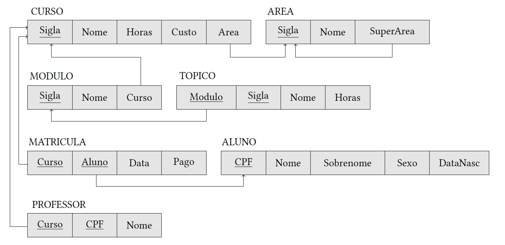

# ${\color{orange}\text{ HO06: SQL (DDL) }}$

## ${\color{orange}\text{ Conceitos Iniciais }}$

### ${\color{orange}\text{ Definição }}$

SQL }}$ → **Structured Query Language** (linguagem de consulta estruturada), é uma linguagem de programação de alto nível, declarativa e não procedural, muito utilizada para realizar a comunicação com o banco de dados por meio de consultas.

As formalidades da implementação de cada consulta ficam a cargo do SGBD.

### ${\color{orange}\text{ Equivalência com o Modelo Relacional }}$

* Relação }}$ → Tabela
* Atributo }}$ → Coluna
* Tupla }}$ → Linha

### ${\color{orange}\text{ Recursos do SQL }}$

SQL é uma linguagem constituída por outras linguagens, que oferecem recursos como:

* Definição de dados (*Data Definition Language* – DDL)
* Definição de armazenamento de dados (*Storage Definition Language* – SDL)
* Manipulação de dados (*Data Manipulation Language* – DML)
* Consulta de dados (*Data Query Language* – DQL)
* Visualização de dados (*View Definition Language* – VDL)
* Controle e restrições de dados (*Data Control Language* – DCL)
* Controle de transações de dados (*Data / Transaction Control Language* – DCL ou TCL)

## ${\color{orange}\text{ SQL: Definição de dados (DDL) }}$

### ${\color{orange}\text{ Definição de Esquema }}$

É a estrutura lógica que define como os dados são organizados, incluindo tabelas, colunas, tipos de dados e relacionamentos.

### ${\color{orange}\text{ Definição de catálogo }}$

O catálogo é descrição dos dados (metadados) que é mantido pelo SGBD, e que armazena as descrições e definições do esquema.

Além disso contém o esquema padrão (**INFORMATION_SCHEMA**) com informações sobre todos esquemas do catálogo, bem como os descritores dos elementos.

### ${\color{orange}\text{ Principais comandos }}$

* CREATE }}$ → cria elementos no catálogo, como esquemas, tabelas e domínios.
* ALTER }}$ → modifica elementos no catálogo.
* DROP }}$ → remove elementos no catálogo. 

**Exemplo**:

``` SQL
CREATE SCHEMA UNIVERSIDADE AUTHORIZATION ‘Pedro’;
```

* Criou um novo esquema de universidade que pertence ao usuário Pedro.

### ${\color{orange}\text{ Tabela Base e Tabela Virtual }}$

A Tabela Base é declarada por meio da instrução `CREATE TABLE`, e é armazenada como um arquivo pelo SGBD.

A Tabela Virtual é declarada por meio da instrução `CREATE VIEW`, ela pode ser criada e armazenada como um arquivo pelo SGBD, mas geralmente não é armazenada em arquivos.

### ${\color{orange}\text{ CREATE TABLE e ALTER TABLE }}$

Criar uma nova tabela especificando seu **nome**, suas **colunas** e **restrições** iniciais.

Uma vez que as colunas e restrições foram criadas, a instrução `ALTER TABLE` pode ser usada para modificá-las.

**Exemplo**:

``` SQL
    CREATE TABLE PROFESSOR;
```

* Uma nova tabela denominada PROFESSOR foi criada. O esquema em que a tabela foi criada é especificado implicitamente no ambiente em que a instrução foi executada.

### ${\color{orange}\text{ Restrições }}$

As restrições são definições de especificidades que podem ser aplicadas durante a criação de uma tabela. As restrições mais importantes que podem ser definidas são:

### ${\color{orange}\text{  1. Restrição de tipo }}$ → o domínio dos valores válidos às colunas de uma tabela.

* Numéricos: `INTEGER`, `SMALLINT`, `FLOAT`, `REAL`, `DOUBLE PRECISION`.
* Cadeias de caracteres: `CHAR(n)` (tamanho fixo), `VARCHAR(n)` (tamanho variável com máximo), `’Valor Literal’` (Case Sensitive).
* Cadeias de bits: `BIT(n)` (tamanho fixo), `BIT VARYING(n)` (tamanho variável com máximo), `B’1010’` (valor literal)
* Booleano: valores binários, verdadeiro (`1`) e falso (`0`)
* Data: `Date` (exatamente DD-MM-YYYY)
* Hora: `Time` (exatamente HH:MM:SS) 
* Timestamp : valores temporais de alta precisão, `TIMESTAMP` (’27-09-2008 09:12:47.648302’)

### ${\color{orange}\text{  2. Restrição de nulidade }}$ → da possibilidade de valores NULL para uma coluna.

* `NOT NULL` para especificar que o valor nulo não pode ser aceito.
* Essa restrição fica implícita quando se trata de chave primária.
* Quando não há especificação, o valor null é permitido.

### ${\color{orange}\text{  3. Restrição de valor }}$ → faixa de valores válidos para uma coluna (limites)

* `ADD CHECK` seguido de uma condição de restrição do valor.

### ${\color{orange}\text{  4. Restrição de valor padrão }}$ → força determinado valor de coluna, caso não haja especificação.

* `DEFAULT` para atribuição de valor padrão.

### ${\color{orange}\text{  5. Restrição de chave }}$ → coluna(s) identificadora(s) de uma instância (linha).

* `PRIMARY KEY` para definição de chave primária restrita a uma coluna (chave simples).

### ${\color{orange}\text{  6. Restrição de unicidade }}$ → coluna(s) candidata(s) a identificadoras, por conta do impedimento de repetição de valores.

* `UNIQUE` para especificar coluna cujos valores são únicos. Pode ser especificado para chaves secundárias.

### ${\color{orange}\text{ 7. Integridade referencial }}$ → regras para atualização de linhas correlacionadas em diferentes tabelas (chaves primárias e estrangeiras).

* `FOREIGN KEY` … `REFERENCES`, cria correlação de linhas relacionadas de tabelas diferentes por colunas chave primária e estrangeira.
* A integridade referencial é a ação tomada pelo SGBD diante de uma exclusão ou modificação.
* `RESTRICT` impede que chave primária seja modificada se houver linhas contendo chaves estrangeiras associados a ela.
* `CASCADE` permite modificação de chave primária, disparando a mesma modificação para todas as chaves estrangeiras associadas a ela.
* `SET NULL` a linha da chave primária é modificada, desde que seja possível atualizar para NULL as chaves estrangeiras associadas a ela.
* `SET DEFAULT` a linha da chave primária é modificada, desde que seja possível atualizar para um valor padrão as chaves estrangeiras associadas a ela.
* `ON DELETE` e `ON UPDATE` remoção e atualização que deve ser seguida de uma ação de disparo garantindo a integridade referencial.

### ${\color{orange}\text{ 8. Restrições nomeadas }}$ → restrições podem ser rotuladas para identificação.

* `CONSTRAITN` é o descritor para nomear uma restrição, que precisa ser exclusiva no esquema.

## ${\color{orange}\text{ Exemplos }}$


``` SQL

CREATE TABLE PROFESSOR (
    CPF CHAR(11) NOT NULL,
    Nome VARCHAR(80) NOT NULL,
    Departamento INT
);

```

* Na tabela professor, a coluna CPF é uma cadeia fixa de 11 caracteres que não pode ser nula, assim como Nome sendo uma cadeia variável de no máximo 80 caracteres. A coluna Departamento é um inteiro que aceita valor nulo. **Note que a definição de colunas é separada por vírgula** 

``` SQL

ALTER TABLE PROFESSOR ADD CHECK
(Departamento > 0 AND Departamento < 21);

```

Alterando a tabela PROFESSOR para adicionar uma nova restrição, a coluna Departamento deverá ser maior que 0 e menor do que 21.

``` SQL

CREATE TABLE PROFESSOR (
    CPF CHAR(11) NOT NULL,
    Nome VARCHAR(80) NOT NULL,
    Departamento INT,
    PRIMARY KEY (CPF)
);

```

* A chave primária da tabela PROFESSOR está definida como sendo a coluna CPF, cuja restrição de valores está especificada antes.

``` SQL

CREATE TABLE PROFESSOR (
    CPF CHAR(11) NOT NULL,
    Nome VARCHAR(80) NOT NULL,
    Departamento INT,
    PRIMARY KEY (CPF),
    UNIQUE (Nome)
);

```

* Definindo como valor único a coluna Nome.

``` SQL

CREATE TABLE PROFESSOR (
    CPF CHAR(11) NOT NULL,
    Nome VARCHAR(80) NOT NULL,
    Departamento INT,
    PRIMARY KEY (CPF),
    FOREIGN KEY (Departamento)
    REFERENCES DEPARTAMENTO(Numero)
);

```

* Definindo a coluna Departamento (previamente definida em valores) da tabela PROFESSOR como chave estrangeira para a tabela DEPARTAMENTO, referenciando a coluna Numero.

``` SQL

CREATE TABLE PROFESSOR (
    CPF CHAR(11) NOT NULL,
    Nome VARCHAR(80) NOT NULL,
    Departamento INT DEFAULT 1,
    PRIMARY KEY (CPF),
    FOREIGN KEY (Departamento)
    REFERENCES DEPARTAMENTO(Numero)
    ON DELETE SET DEFAULT ON UPDATE CASCADE
);

```

* Definindo integridade referencial entre a tabela PROFESSOR e DEPARTAMENTO: Se um departamento for **excluído** da tabela DEPARTAMENTO, o banco de dados não apagará o professor, em vez disso, o valor será atualizado em `DEFAULT 1`. Se o Numero de um departamento for **alterado** na tabela DEPARTAMENTO, o banco de dados atualizará automaticamente essa informação em todos os professores vinculados a ele pela cláusula `CASCADE`.
``` SQL

CONSTRAINT PK_PROFESSOR PRIMARY KEY (CPF);
    CONSTRAINT FK_DEPARTAMENTO_PROFESSOR
    FOREIGN KEY (Departamento)
    REFERENCES DEPARTAMENTO(Numero)
    ON DELETE SET DEFAULT ON UPDATE CASCADE;

```

* Quando você escreve apenas `PRIMARY KEY` ou `FOREIGN KEY`, o próprio banco de dados gera um nome automático e aleatório para essa regra (algo como `SYS_C0012345` ou `FK_1a2b3c4d`). Ao usar `CONSTRAINT, tem-se o controle dos nomes das regras, permitindo algo como:

``` SQL

ALTER TABLE PROFESSOR DROP CONSTRAINT FK_DEPARTAMENTO_PROFESSOR;

```

## ${\color{orange}\text{ Atividade do Hands-On }}$

Construir um diagrama de implementação do banco de dados SAM a partir do modelo relacional abaixo e especificar consultas em SQL para criar o esquema, as tabelas e restrições (domínio, nulidade, unicidade, valor, valor padrão, chave e integridade referencial) do banco de dados SAM.

<p align="center">

</p>

A seguir, a sequência de códigos executados no MySQL Workbench:

```SQL
    -- 1. Criação do Esquema
    CREATE SCHEMA IF NOT EXISTS sam;
    USE sam;

    -- 2. Tabela ALUNO
    CREATE TABLE ALUNO (
        CPF VARCHAR(11) NOT NULL,
        Nome VARCHAR(50) NOT NULL,
        Sobrenome VARCHAR(50) NOT NULL,
        Sexo CHAR(1) NOT NULL,
        DataNasc DATE NOT NULL,
        PRIMARY KEY (CPF),
        CONSTRAINT chk_sexo CHECK (Sexo IN ('M', 'F', 'O'))
    );

    -- 3. Tabela AREA (Auto-relacionamento)
    CREATE TABLE AREA (
        Sigla VARCHAR(10) NOT NULL,
        Nome VARCHAR(100) NOT NULL UNIQUE,
        SuperArea VARCHAR(10) NULL,
        PRIMARY KEY (Sigla),
        FOREIGN KEY (SuperArea) REFERENCES AREA(Sigla)
            ON DELETE SET NULL 
            ON UPDATE CASCADE
    );

    -- 4. Tabela CURSO
    CREATE TABLE CURSO (
        Sigla VARCHAR(10) NOT NULL,
        Nome VARCHAR(100) NOT NULL,
        Horas INT NOT NULL DEFAULT 0,
        Custo DECIMAL(10,2) NOT NULL DEFAULT 0.00,
        Area VARCHAR(10) NOT NULL,
        PRIMARY KEY (Sigla),
        FOREIGN KEY (Area) REFERENCES AREA(Sigla)
            ON DELETE RESTRICT 
            ON UPDATE CASCADE,
        CONSTRAINT chk_horas CHECK (Horas >= 0),
        CONSTRAINT chk_custo CHECK (Custo >= 0.00)
    );

    -- 5. Tabela MODULO
    CREATE TABLE MODULO (
        Sigla VARCHAR(10) NOT NULL,
        Nome VARCHAR(100) NOT NULL,
        Curso VARCHAR(10) NOT NULL,
        PRIMARY KEY (Sigla),
        FOREIGN KEY (Curso) REFERENCES CURSO(Sigla)
            ON DELETE CASCADE 
            ON UPDATE CASCADE
    );

    -- 6. Tabela TOPICO
    CREATE TABLE TOPICO (
        Modulo VARCHAR(10) NOT NULL,
        Sigla VARCHAR(10) NOT NULL,
        Nome VARCHAR(100) NOT NULL,
        Horas INT NOT NULL DEFAULT 1,
        PRIMARY KEY (Modulo, Sigla),
        FOREIGN KEY (Modulo) REFERENCES MODULO(Sigla)
            ON DELETE CASCADE 
            ON UPDATE CASCADE,
        CONSTRAINT chk_topico_horas CHECK (Horas > 0)
    );

    -- 7. Tabela MATRICULA
    CREATE TABLE MATRICULA (
        Curso VARCHAR(10) NOT NULL,
        Aluno VARCHAR(11) NOT NULL,
        Data DATE NOT NULL,
        Pago BOOLEAN NOT NULL DEFAULT FALSE,
        PRIMARY KEY (Curso, Aluno),
        FOREIGN KEY (Curso) REFERENCES CURSO(Sigla)
            ON DELETE RESTRICT 
            ON UPDATE CASCADE,
        FOREIGN KEY (Aluno) REFERENCES ALUNO(CPF)
            ON DELETE RESTRICT 
            ON UPDATE CASCADE
    );

    -- 8. Tabela PROFESSOR
    CREATE TABLE PROFESSOR (
        Curso VARCHAR(10) NOT NULL,
        CPF VARCHAR(11) NOT NULL,
        Nome VARCHAR(100) NOT NULL,
        PRIMARY KEY (Curso, CPF),
        FOREIGN KEY (Curso) REFERENCES CURSO(Sigla)
            ON DELETE CASCADE 
            ON UPDATE CASCADE
    );
```