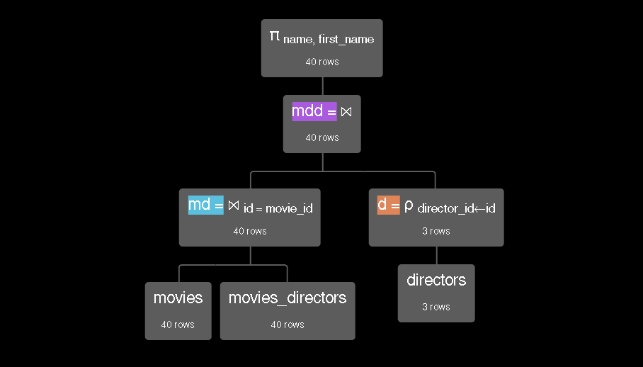
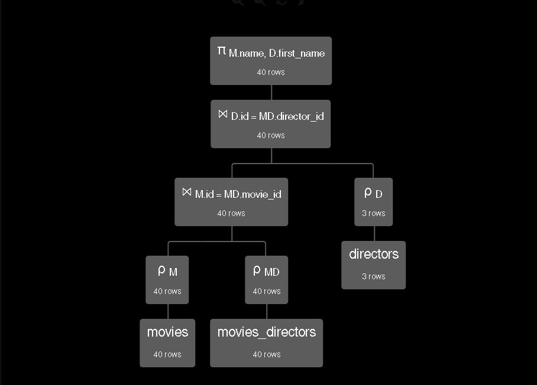

# ${\color{orange}\text{ HO07: SQL (DML) }}$

## ${\color{orange}\text{ Conceitos Iniciais }}$

Em continuidade com as ferramentas do SQL, a manipulação de dados é uma das mais importantes (*Data Manipulation Language* – DML).

### ${\color{orange}\text{ Quatro principais instruções }}$

* `INSERT` → inserir linhas em tabelas.
* `DELETE` → remover linhas em tabelas.
* `UPDATE` → atualizar valores de colunas em linhas de tabelas.
* `SELECT` →  recuperar dados em tabelas.

### ${\color{orange}\text{ INSERT }}$

Deve-se especificar o nome da tabela e a lista de valores para a linha, correspondente a cada coluna listada na mesma ordem que foram definidas na tabela.

**Exemplo**:

**PROFESSOR** \
| <u>CPF</u> | NOME | SEXO | SALARIO | DEPARTAMENTO |

``` SQL

INSERT INTO PROFESSOR VALUES
(’12345678900’, ’Ricardo Marini’, ’M’, 3000.00, 1);

```

Uma outra possibilidade é especificar as colunas e os valores a serem inseridos.

``` SQL

INSERT INTO PROFESSOR (CPF, Sexo, Nome, Departamento)
VALUES (’12345678900’, ’M’, ’Ricardo Marini’, 1)

```

**Obs.**: valores não especificados são atribuídos como `NULL` ou `DEFAULT` a depender de como as restrições de valores foram impostas.

### ${\color{orange}\text{ INSERT + SELEC\text{T} }}$

É possível inserir múltiplas linhas em uma tabela combinando com a instrução `INSERT` com `SELECT`.

``` SQL

INSERT INTO PROFESSOR (CPF, Nome, Sexo, Departamento)
SELECT CPF, Nome, Sexo, 1
FROM ALUNO;

```

* Todas as linhas da tabela aluno serão inseridas na tabela professor. Para a coluna Departamento, o valor é inserido como sendo 1 em todas as linhas.

### ${\color{orange}\text{ DELETE }}$

A exclusão é realizada em apenas uma linha da tabela por operação, salve pela exceção onde a exclusão se propaga por conta das restrições de integridade referencial.

Esse tipo de instrução pode ser especificado por uma condição, que é aplicada por meio de uma cláusula `WHERE`. Quando não há condição, entende-se que todas as linhas serão apagadas, fazendo com que a tabela fique vazia.

**Exemplo**:

``` SQL

DELETE FROM PROFESSOR
WHERE Salario < 1000,00;

// ou

DELETE FROM PROFESSOR
WHERE Sexo = ’M’;

// ou

DELETE FROM PROFESSOR;

```


### ${\color{orange}\text{ UPDATE }}$

Modifica valores em colunas de uma ou mais linhas. Cada instrução aplica-se apenas a uma tabela, salve pela exceção da integridade referencial.

Para especificar colunas a serem modificadas e seus novos valores, usa-se a cláusula `SET`, e a linha pode ser encontrada pela cláusula `WHERE`.

**Exemplo**:

``` SQL


UPDATE PROFESSOR
SET Salario = 2500,00, Departamento = 2
WHERE CPF = ’12345678900’;

// ou

UPDATE PROFESSOR
SET Salario = Salario * 1.1;

```

### ${\color{orange}\text{ SELEC\text{T} }}$

Consegue recuperar linhas em múltiplas tabelas. A operação segue uma forma básica conhecida como padrão *SELECT–FROM–WHERE*:

```SQL

SELECT <lista de colunas>
FROM   <lista de tabelas>
WHERE  <condição>;

```

* **Lista de colunas**: nomes das colunas onde os valores devem ser recuperados na consulta.
* **Lista de tabelas**: nomes das tabelas onde os dados se encontram.
* **condição**: a expressão condicional que identifica linhas que devem ser recuperadas na consulta.

**Exemplo**:

``` SQL

SELECT Nome, Salario
FROM   PROFESSOR
WHERE  Departamento = 1
AND    Sexo = ’M’;

```

* Recupera Nome e Salario da tabela PROFESSOR onde departamento é 1 e Sexo é ‘M’.

``` SQL

SELECT A.CPF, A.Nome
FROM   PROFESSOR A, ALUNO B
WHERE  A.CPF = B.CPF
AND    A.Sexo = ’M’;

```

* Recupera CPF e Nome da tabela PROFESSOR renomeada para A onde professores são alunos (renomeados como B) por meio do CPF e os professores são do Sexo igual a ‘M’.

``` SQL

SELECT  A.Nome AS Departamento, B.Nome AS Professor
FROM    DEPARTAMENTO A, PROFESSOR B, ALUNO C
WHERE   A.Numero = B.Departamento
AND     B.CPF = C.CPF
AND     A.Nome = ’Pesquisa’;

```

* Recupera Nome do departamento e nome do professor, onde Numero do departamento é o mesmo que o Departamento do professor, e o professor também é aluno do departamento de pesquisa.
* **A palavra-chave `AS` é opcional na maioria dos bancos de dados** (poderia escrever A.Nome Departamento). No entanto, **usar o `AS` é considerado uma boa prática** porque deixa explícito que você está renomeando a coluna, no caso, como Departamento e como Professor, evitando a ambiguidade de nomes.

### ${\color{orange}\text{ SELEC\text{T} + JOIN }}$

Junções podem ser especificadas tanto na cláusula `WHERE` quando na cláusula `FROM` com o uso do operador `JOIN`.

**Exemplo**:

```SQL

SELECT  A.CPF, A.Nome
FROM    PROFESSOR A, ALUNO B
WHERE   A.CPF = B.CPF
AND     A.Sexo = ’M’;

```

* Recupera CPF e Nome de alunos que são professores e do sexo masculino.

```SQL

SELECT  A.CPF, A.Nome
FROM    PROFESSOR A JOIN ALUNO B ON A.CPF = B.CPF
WHERE   A.Sexo = ’M’;

```

* Junta a tabela professores com a tabela alunos para a correspondência da coluna CPF, depois seleciona o CPF e o nome da tabela resultante onde o sexo é igual a ‘M’.

**Obs.**: O princípio é bem parecido com álgebra relacional, além disso existem variações da operação de junção como: `INNER JOIN`, `LEFT / RIGHT OUTER JOIN` e `FULL JOIN`.

### ${\color{orange}\text{ Ambiguidade }}$

O mesmo nome pode ser usado em mais de uma coluna, desde que as colunas pertençam a tabelas diferentes e estejam devidamente prefixadas para evitar ambiguidade.


```SQL

SELECT  PROFESSOR.Nome, ALUNO.Nome
FROM    PROFESSOR, ALUNO
WHERE   PROFESSOR.CPF = ALUNO.CPF
AND     PROFESSOR.Sexo = ’M’;

```

* Seleção dos atributos ‘Nome’ das tabelas PROFESSOR e ALUNO, prefixados com o nome das tabelas.

```SQL

SELECT  A.Nome, B.Nome
FROM    PROFESSOR A, ALUNO B
WHERE   A.CPF = B.CPF
AND     A.Sexo = ’M’;

```

* Seleção dos atributos ‘Nome’ das tabelas PROFESSOR e ALUNO, prefixados com o nome das tabelas **renomeadas na cláusula FROM**.

### ${\color{orange}\text{ Ausência de cláusula WHERE }}$

É quando há inexistência de condições para seleção e junção de linhas, trazendo impactos diferentes no resultado das consultas.

* **Tabela única** → todas as linhas da tabela especificada serão retornadas.

```SQL

SELECT  CPF
FROM    PROFESSOR;

```

* **Múltiplas tabelas** → todas as combinações possíveis entre as linhas das tabelas especificadas serão retornadas, equivalendo à operação **Produto Cartesiano** da álgebra relacional.

```SQL

SELECT  CPF
FROM    PROFESSOR A, DEPARTAMENTO B;

```

### ${\color{orange}\text{ Distinção de duplicatas }}$

Quando uma tabela constitui um conjunto de linhas duplicadas (tuplas idênticas), elas podem aparecer no resultado de uma consulta.

* `DISTINCT` → Elimina essas linhas duplicadas no resultado final.

**Exemplo**:

```SQL

SELECT  Departamento
FROM    PROFESSOR
WHERE   Salario < 5000.00;

```

* Pode apresentar duplicatas no resultado.

```SQL

SELECT  DISTINCT Departamento
FROM    PROFESSOR
WHERE   Salario < 5000.00;

```

* Irá eliminar as duplicatas do resultado.

**Obs.**: O custo computacional para eliminar tuplas duplicadas é relativamente caro, tendo um custo medido entre O(N Log N) e O(N), portanto deve-se usar com cuidado e somente quando estritamente necessário. Nem toda ferramenta que o SQL oferece deve ser usada de maneira leviana, tudo deve ser pensado e medido antes de sua execução.


### ${\color{orange}\text{ Operadores Especiais }}$

* `SELECT *` → recupera todas as colunas das linhas selecionadas, sem a necessidade de listar seus nomes explicitamente. Também funciona na álgebra relacional.

```SQL

SELECT  *
FROM    PROFESSOR
WHERE   departamento = 1;

```

Recupera todas as colunas de professores que trabalham no departamento de número 1.

* **`LIKE`** → comparação sobre subcadeias de caracteres, especificadas usando dois caracteres especiais:
	* **porcentagem (`%`)** → substitui zero ou mais caracteres.
	* ***underline* (`_`)** → substitui um único caractere.

```SQL

SELECT  CPF, Nome
FROM    PROFESSOR
WHERE   Endereco LIKE ’%Belo Horizonte%’;

```

Recupera o CPF e nome de todos os professores em que seu endereço contenha a subcadeia de caracteres Belo Horizonte.

* `BETWEEN` → Comparação com intervalos de valores para colunas.

```SQL

SELECT  * FROM PROFESSOR
WHERE   Salario BETWEEN 2000,00 AND 5000,00;

```

Recupera todas as colunas de professores com salários entre 2 e 5 mil.

* `ORDER BY`  → ordena as linhas do resultado de uma consulta.

    * `ASC` → operador padrão para ordenação crescente
    * `DESC` → operador para ordenação decrescente

```SQL

SELECT   A.Nome, B.Nome
FROM     DEPARTAMENTO A, PROFESSOR B
WHERE    A.Numero = B.Departamento
ORDER BY B.Nome, A.nome DESC;

```

Recupera o nome do departamento e do professor para todos os professores que trabalham em um departamento ordenando o resultado de maneira crescente pelo nome do professor e decrescente pelo nome do departamento.

* `IS NULL` (`IS NOT NULL`) → verifica se valor de coluna é NULL ou não.

    * **⚠ NULL tem semântica imprecisa !**
    * Valor desconhecido ?
    * Valor indisponível ?
    * Valor não aplicável ?

```SQL

    SELECT  CPF, Nome
    FROM    PROFESSOR
    WHERE   Departamento IS NULL;

```

Recupera o CPF e o nome dos professores que não trabalham em algum departamento.

### ${\color{orange}\text{ Consulta Aninhada }}$

Quando há um bloco `SELECT` completo na cláusula `WHERE` de outra consulta, denominando-se de consulta externa.

* `IN` (`NOT IN`) → verifica se um conjunto de valores pertence a um multiconjunto de valores.

```SQL
SELECT  A.Nome, A.Salario
FROM    PROFESSOR A
WHERE   (A.CPF, A.Nome) IN (
            SELECT B.CPF, B.Nome
            FROM ALUNO B
            WHERE A.Sexo = B.Sexo
        );
```

Recupera nome e salário dos professores que possuem mesmo CPF e nome de algum aluno, desde que tenham o mesmo sexo.

* `EXISTS` (`NOT EXISTS`) → verifica se o resultado da consulta interna é conjunto vazio.

```SQL

SELECT  A.CPF, A.Nome
FROM    PROFESSOR A
WHERE   NOT EXISTS (
        SELECT  * FROM DEPARTAMENTO B
        WHERE   A.Departamento = B.Numero
        AND     B.Nome = ’Pesquisa’
        );

```

Retorna CPF e nome dos professores que não trabalham no departamento de nome Pesquisa.

### ${\color{orange}\text{ Agregação }}$

* `GROUP BY` → agrupa múltiplas linhas em uma, utilizando as funções de agregação.

    * `COUNT` → conta o número de linhas agrupadas.
    * `SUM` → soma o valor na coluna de linhas agrupadas.
    * `MAX` → retorna o valor máximo na coluna de linhas agrupadas.
    * `MIN` → retorna o valor mínimo na coluna de linhas agrupadas.
    * `AVG` → retorna a média dos valores na coluna de linhas agrupadas.

Funções de agregação não têm efeito em linhas com colunas participantes da função com valor NULL, ou seja, valores NULL não surtem efeito no resultado final.

**Exemplos**:

```SQL

SELECT  COUNT(*), SUM(Salario)
FROM    PROFESSOR
WHERE   Sexo = ’F’;

```

Retorna o número de professores do sexo feminino e a soma do salário pago a elas.

```SQL

SELECT  Departamento, 
        COUNT(*), 
        SUM(Salario),
        MAX(Salario), 
        MIN(Salario), 
        AVG(Salario)
FROM    PROFESSOR GROUP BY Departamento;

```

Para cada departamento retorna seu número, a quantidade de professores, a soma dos salários, o salário máximo, mínimo e a média salarial.

Em álgebra relacional e na calculadora RelaX seria algo como, respectivamente: 

* **Departamento γ <sub>COUNT(*), SUM(Salario), MAX(Salario), MIN(Salario), AVG(Salario)</sub> (PROFESSOR)**

* **γ Departamento ; COUNT(*)→A, SUM(Salario)→B, MAX(Salario)→C, MIN(Salario)→D, AVG(Salario)→E (PROFESSOR)**


* `HAVING` → remove linhas do resultado agregado de acordo com a condição imposta sobre as funções de agregação.

**Exemplos**:

```SQL

SELECT  Departamento, COUNT(*), SUM(Salario)
FROM    PROFESSOR GROUP BY Departamento
HAVING  AVG(Salario) > 8000.00;

```

Para cada departamento retorna seu número, a quantidade de professores e a soma de salários, desde que a média salarial do departamento seja maior que 8000,00.

## ${\color{orange}\text{ Atividade do Hands-On }}$

Especificar as seguintes consultas em SQL para recuperar os dados em um banco de dados relacional, considerando o conjunto de dados (dataset) denominado [IMDB-sample](https://dbis-uibk.github.io/relax/calc/gist/41cf5ce652756d9331eec7562644e074/imdbsample/0) disponível na calculadora [RelaX](https://dbis-uibk.github.io/relax/landing):

**1. Projetar o primeiro nome e o último nome dos atores de sexo feminino**

Em álgebra relacional:

```
π first_name, last_name (σ gender = 'F' (actors))
```

Em SQL:

```SQL

SELECT 	first_name, last_name
FROM	actors
WHERE	gender = 'F';

```

**2. Projetar o nome dos filmes com ano superior à 1999**

Em álgebra relacional:

```
π name (σ year>1999 (movies))

```

Em SQL:

```SQL

SELECT  name
FROM    movies
WHERE   year > 1999;

```

**3. Projetar o nome do filme e o nome do diretor de cada filme**

Em álgebra relacional:

```
-- junta filmes com a relação de filmes-diretores pelo id
md = (movies) ⨝ id = movie_id (movies_directors)

-- renomeia id da relação diretores
d = ρ director_id←id (directors)

-- junção natural de md com d
mdd = md ⨝ d

-- projeção
π name, first_name (mdd)
```

Árvore correspondente:

<p align="center">

</p>

Em SQL:

```SQL

SELECT  M.name, D.first_name
FROM    movies AS M
        JOIN movies_directors AS MD 
        ON M.id = MD.movie_id
        JOIN directors AS D 
        ON D.id = MD.director_id

```

Árvore correspondente:

<p align="center">

</p>

**4. Projetar o nome do filme, nome do ator e o papel que cada ator teve no filme para filmes com ranking acima da nota 6**

Em álgebra relacional:

```
-- filmes com rank acima de 6
m = σ rank > 6 (movies)

-- junta filmes e papeis pelo id
mr = m ⨝ id = movie_id roles

-- renomeia id de atores para permitir junção natural
a = ρ actor_id←id (actors)
amr  = mr ⨝ a

-- projeção
π name, first_name, role (amr)
```

Em SQL:

```SQL

/* 
Essa é uma forma realizada com um consulta externa na cláusula FROM,
permitindo que a seleção seja executada antes da junção,  permitindo
visibilidade de uma árvore otimizada no RelaX.
*/

SELECT M.name, A.first_name, P.role
FROM (
    SELECT *
    FROM movies
    WHERE movies.rank > 6
    ) AS M
    JOIN roles AS P
    ON M.id = P.movie_id
    JOIN actors AS A
    ON A.id = P.actor_id

/*
Na prática, a otimização de consultas fica a cargo do SGBD, ou seja,
a forma mais simples de expressar uma consulta é a mais indicada por
ser a mais legível, entretanto, isso não significa que as instruções
serão executadas na ordem em que foram declaradas.
*/

SELECT  M.name, A.first_name, P.role 
FROM    movies AS M
        JOIN roles AS P ON M.id = P.movie_id 
        JOIN actors AS A ON A.id = P.actor_id
WHERE   M.rank > 6

```

**5. Projetar o nome do diretor e o número de filmes que cada diretor dirigiu**

Em álgebra relacional:

```
-- agrupar número de filmes por diretor
nfpd = γ director_id ; COUNT(movie_id)→nFilmes (movies_directors)

-- juntar para obter número de filmes e nome dos diretores
nfnd = (nfpd) ⨝ director_id = id (directors)

-- projetar
π first_name, nFilmes (nfnd)
```

Em SQL:

```SQL

SELECT  D.first_name, COUNT(*) AS nFilmes
FROM    directors AS D JOIN movies_directors AS MD 
        ON D.id = MD.director_id
        GROUP BY D.first_name

```

**6. Projetar o gênero e o número de filmes de cada gênero** 

Em álgebra relacional:

```
γ genre ; COUNT(movie_id)→nFilmes (movies_genres)
```

Em SQL:

```SQL

SELECT  genre, COUNT(*) AS nFilmes
FROM    movies_genres
        GROUP BY genre

```

**7. Projetar o gênero, o ranking (nota) médio, mínimo e máximo dos filmes do gênero**

Em álgebra relacional:

```
-- juntar filmes com a relação filmes-gêneros
fg = (movies) ⨝ id = movie_id (movies_genres)

-- agregar rank por gênero
γ genre ; AVG(rank)→medRank, MIN(rank)→minRank, MAX(rank)→maxRank (fg)
```

Em SQL:

```SQL

SELECT  MG.genre,
        AVG(M.rank) AS medRank,
        MIN(M.rank) AS minRank,
        MAX(M.rank) AS maxRank
FROM    movies_genres AS MG
		JOIN movies AS M
		ON MG.movie_id = M.id
        GROUP BY MG.genre

```